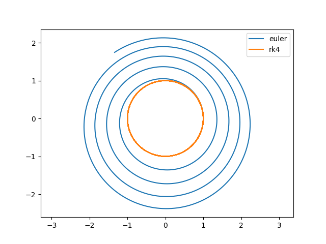

# ODE Solver in C++

A small C++20 library for the numerical integration of ordinary differential equations
y′ = f(t, y), with the explicit Euler and classical fourth-order Runge–Kutta (RK4) methods.
The solvers are verified against problems with exact solutions and applied to the
two-body Kepler problem.

Built as a learning project in modern C++ (modules, CMake, Eigen, lambdas).

## Features

- Explicit Euler and classical RK4 time-stepping methods
- Generic interface: any right-hand side `f(t, y)` and any stepping method can be passed
  as a function or lambda
- Single integration loop with an *observer* callback, used to store the full trajectory
  or only the final state
- Convergence tests on problems with known solutions (harmonic oscillator, y′ = cos t)
- CSV output of trajectories and a Python script for plotting

## Requirements

- C++20 compiler (tested with g++ 13)
- CMake ≥ 3.20
- [Eigen 3](https://eigen.tuxfamily.org) (on Ubuntu: `sudo apt install libeigen3-dev`)
- Python 3 with NumPy and Matplotlib (only for plotting)

## Build and run

```
cmake -S . -B build
cmake --build build
./build/main
python3 scripts/plot_orbit.py
```

`./build/main` integrates the Kepler problem and writes `orbit_euler.csv` and
`orbit_rk4.csv` to the current directory; the script plots both orbits into `orbits.png`.

## Results

### Convergence

Harmonic oscillator x″ = −x, x(0) = 1, v(0) = 0, error |x(T) − cos T| at T = 10.
The error ratio under step halving approaches 2 for Euler and 16 for RK4, confirming
orders 1 and 4.

| n    | Euler error | ratio | RK4 error   | ratio |
|------|-------------|-------|-------------|-------|
| 100  | 5.70e-01    | –     | 3.94e-06    | –     |
| 200  | 2.44e-01    | 2.34  | 2.65e-07    | 14.86 |
| 400  | 1.13e-01    | 2.16  | 1.71e-08    | 15.46 |
| 800  | 5.44e-02    | 2.08  | 1.09e-09    | 15.74 |
| 1600 | 2.67e-02    | 2.04  | 6.86e-11    | 15.87 |
| 3200 | 1.32e-02    | 2.02  | 4.31e-12    | 15.93 |

The non-autonomous test y′ = cos t, y(0) = 0 gives the same orders. It also checks that
the correct time t is passed to the right-hand side, which the oscillator cannot detect.

### Kepler orbit

Two-body problem in units GM = 1:
r′ = v, v′ = −r / |r|³, initial state r = (1, 0), v = (0, 1) (circular orbit, period 2π).
Ten revolutions with n = 2000 steps:

| Method | Final radius | Final energy (exact −0.5) |
|--------|--------------|---------------------------|
| Euler  | 2.20         | −0.2113                   |
| RK4    | 1.000        | −0.50000003               |

Euler spirals outwards and gains energy, while RK4 keeps the orbit and conserves energy
to about 3·10⁻⁸.



## Project structure

```
CMakeLists.txt         build configuration
types.h                common types: State (Eigen::VectorXd), Rhs
ode.h / ode.cpp        stepping methods, integration loop, trajectory
io.h / io.cpp          CSV output
main.cpp               test problems, convergence table, Kepler orbit
scripts/plot_orbit.py  plotting of the computed orbits
docs/orbits.png        figure for this README
```

The solver (`ode`) and output (`io`) modules are built as separate libraries and depend
only on `types.h`, not on each other.
